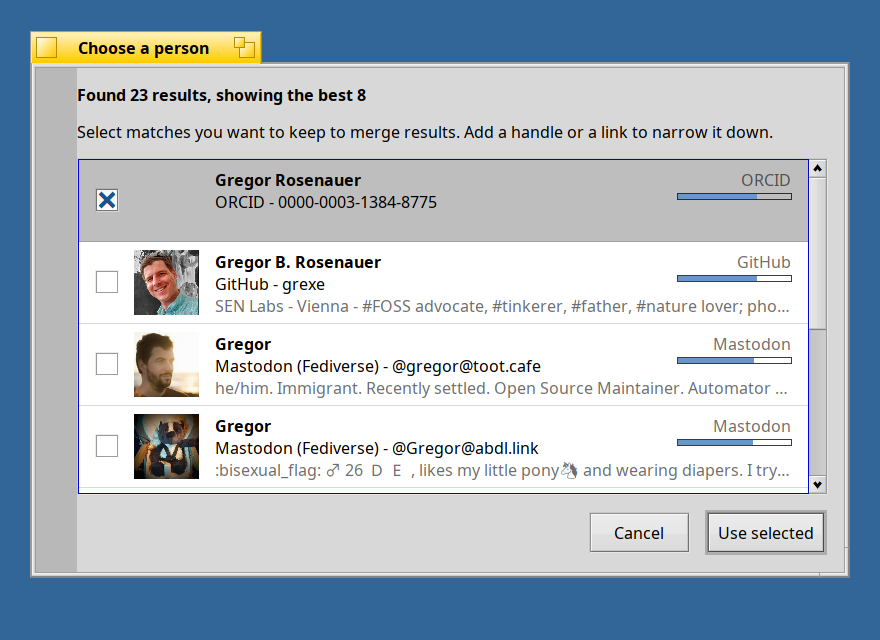

<!--
SPDX-License-Identifier: MIT
SPDX-FileCopyrightText: 2026 SEN Labs e.U.
-->

<h1 align="center">SEN Robin — Enriching People</h1>

<p align="center">
  <em>"Robin — Enriching People"</em><br/>
  The SEN person enricher for Haiku OS.
</p>

Robin enriches people and contacts (`entity/x-vnd.sen-labs.entity.person` and `application/x-person`) with what their own links and addresses lead to: a public photo, a short profile, the
accounts they name, and their posts, from open services. What it goes by is what the file says: the **links** (`schema:sameAs`), the **homepage**, the **e-mail address**, and the **handle**
(`foaf:nick`, with or without the `@`).

A person that has a name or a handle but none of those is **searched for** (the *hunt*): Bluesky, the Fediverse (Mastodon), GitHub, Wikidata and ORCID are asked by the name and the handle, the
answers are scored against everything that the file says (the name, the handle, a link, the place, the company), and the best one is taken if it is clearly the one. Otherwise a **dialog** shows
the candidates with the score, and their photos, which come after the window, and the user chooses; with `--auto` the best one is taken. More than eight matches are said to be too many: the best
eight are shown. Several matches can be checked (your ORCID record and your GitHub account are the same person): they are merged from the top of the list to the bottom (the rows can be dragged, or moved
with Ctrl or Alt and the arrow keys, to say which one wins), and a value that the file has already, or that a match above has given, is never overwritten.

 Nothing is guessed in silence: a hit becomes the links of the person, and the enrichment follows them.

| Feature | What it does | Network |
|---|---|---|
| **enrich** | Finds the photo, the text, the job, the verified links, the feed of the posts and the latest post of a person, and writes them into the standard attributes of the file. | yes |
| **posts** (for the personal relation navigator) | Fetches the posts of a person again and makes them the files that the relation *status* shows. | on demand |

```sh
SenPersonEnricher --auto contact.person    # enrich a contact (the default for a program that asks)
SenPersonEnricher --wipe contact.person    # replace the photo and the posts that are there
SenPersonEnricher --debug contact.person   # say what is asked
```

## Where it looks

```
                    [ a person file ]
                           |
     +---------------------+----------------------+
     |                     |                      |
 foaf:mbox            schema:sameAs           foaf:homepage
     |               (links of accounts)         |
 Libravatar, Gravatar    |                  <link rel="alternate">
 (photo; profile with    +-- github.com/<user>      of the page: the RSS or
  the accounts that      |     profile, photo         Atom feed
  Gravatar verified)     +-- https://host/@user
                         |     (Fediverse: WebFinger, actor: photo, text, outbox)
                         +-- bsky.app/profile/<handle>
                               (profile: photo, text; the posts)
                           |
                 the feed of the posts: `foaf:weblog`
                 the latest post: `foaf:status`, `SEN:statusDate`
```

1. **E-mail** (`foaf:mbox`, `META:email`): the address is made lower case and hashed with SHA-256 **on this computer**; the services get the hash, never the address. Libravatar (`seccdn.libravatar.org`),
   then Gravatar (`gravatar.com`, `api.gravatar.com`): the photo, and from the profile the job, the company, the place, the text and the accounts that the person verified there.
2. **Accounts** (the links of `schema:sameAs`, and `@user@host` as the nickname):
   - **GitHub** (`github.com/<user>`): profile, photo, company, homepage.
   - **Fediverse** (`https://host/@user`, `@user@host`): WebFinger, then the actor (photo, text, outbox). ActivityPub is asked for with `Accept: application/activity+json`, as Mastodon wants; the
     outbox of Mastodon is only the collection, so the first page of it is asked for. Boosts and replies are not what the person says and are left out.
   - **Bluesky** (`bsky.app/profile/<handle>`): profile (photo, text) and the posts. Bluesky names a post by an AT URI (`at://did:plc:…/app.bsky.feed.post/…`), which no browser opens: the link
     of a post is made `https://bsky.app/profile/<handle>/post/<key>`. Reposts are left out. The feed that the person keeps is the RSS feed of the profile.
3. **Homepage** (`foaf:homepage`): the RSS or Atom feed that the page names with `<link rel="alternate">`.

A **link of a service that is not a Fediverse server** (`medium.com/@name`, `bsky.app`, ...) is not asked for; a nickname that looks like an e-mail address is not a handle.

## Attributes

Robin fills only what the file does not have yet (`--wipe` replaces), with the established vocabularies:

| Attribute | Term | What |
|---|---|---|
| `Media:Thumbnail` | system | the photo, shown by Tracker |
| `schema:image`, `schema:creditText`, `schema:license` | schema.org | where the photo is from, whom to thank, its licence |
| `schema:jobTitle` | schema.org | the job |
| `schema:worksFor` | schema.org | the company or organization |
| `schema:homeLocation` | schema.org | where the person lives, as it says |
| `vivo:orcidId` | VIVO | the ORCID iD of a researcher |
| `foaf:nick` | FOAF | the **handle**: a Fediverse handle `@user@server`, a Bluesky handle (a domain: `alice.bsky.social`, `sen-labs.org`), a GitHub login; written without a doubled `@` |
| `dc:description` | Dublin Core | the text of the profile |
| `foaf:homepage` | FOAF | the homepage |
| `schema:sameAs` | schema.org | the links of the accounts (a list) |
| `foaf:weblog` | FOAF | the **feed** of the posts: an RSS or Atom feed, the outbox of an ActivityPub actor, the RSS feed of a Bluesky profile (FOAF: "a weblog of some thing") |
| `foaf:status` | FOAF | the latest post, in one line (what somebody wrote is decoded: `&#8217;` is `’`) |
| `SEN:statusDate` | SEN | **when the latest post was made** (`'TIME'`), as the feed says it, not when it was found |

The ontology is in `sen-oni` (`schema/sen-people.yaml`).

## The posts: the relation *status*

The person file keeps the feed and the latest post, **not** the posts (that would be attributes that change by the hour). The posts are **Markdown files** in the cache,
`~/config/cache/sen/people-enricher/statuses/<SEN:ID or inode of the person>/` (the name of the person is no key: two people can have one name, and a person can be renamed), named by their time so that they sort
by it: `2026-11-08 18.00 - First words of the post.md` (type `text/markdown`, `dc:title`, `dc:date` the time of the post, `schema:url` the address on the web). The relation *status* of a person
(*Open related… › Status*, resolved by the **personal relation navigator**) shows them.

- The posts are **fetched again when the last time is more than an hour ago**: the navigator asks Robin (`posts`), which asks the feed, writes the files of the posts that are there and takes away
  those of posts that are gone. A machine that is offline shows the posts it has, and tries again after five minutes. A feed that does not answer does not empty the folder.
- A person with a latest status and no posts has one file, `Current Status.md`.
- A person that has **no feed, no links and no homepage**: with the setting **Enrich automatically on demand** (settings of SEN, *Plugins › Enrich*, on by default) Robin enriches it now; switched off,
  a notification says that there is nothing to show yet and that the person has to be enriched first.

```sh
SenPersonalRelationNavigator --debug relation/x-vnd.sen-labs.relation.person.status contact.person    # what the relation shows
```

## The services of the search

In the settings of SEN (Plugins, Enrich, SEN Robin) a table lists the services of the hunt, each with a box and a short note; **drag a row** to change the order in which they are asked, switch one
off to leave it out. The file `~/config/settings/sen/robin.settings` keeps them as `hunt = bluesky mastodon -github wikidata orcid` (a `-` is off and keeps its place) and the servers of the Fediverse
that are asked for accounts by name as `mastodon_servers = mastodon.social`. A handle `user@server` is asked at its own server; a domain is a Bluesky handle if there is an account of that name.

**What is sent:** a name or a handle, to the services that are on; all of them are public places where people put themselves on purpose. The photo of a hit is fetched only for the dialog and for the
file; of the photos that were found, the larger one is the thumbnail.

## Privacy and politeness

- **E-mail**: hashed here with SHA-256; the services get the hash, not the address. (A hash of an address is still a name for it: whoever knows the address can ask for the same hash. Enriching a person is
  something that you ask for, and a person that you do not enrich is not asked about.)
- **Rates**: at least 500 ms between two requests, over all processes (`rate_stamp` in the cache).
- **Caches** (`~/config/cache/sen/people-enricher/`): what services answer about a profile or a photo is kept for 7 days, a feed for 1 hour. Offline, what is kept is shown.
- The requests go over the SEN socket client (`SenSocketHttp.h`): it sends `Accept`, follows redirects and reads the hosts that Haiku's HTTP client cannot.

## Not yet

Rows for `schema:sameAs` that the person verified on Mastodon (`rel="me"`); X, Instagram and LinkedIn have no open interface, so they are not searched: a link that the person has is kept.

## Build and test

```sh
sh tests/run.sh              # the portable core (text, dates, feeds, who a profile is, the cascade with scripted services): runs on a Mac (JSON_INCLUDE=<folder with nlohmann/>)
make                         # on Haiku (mkdir bin first)
```
