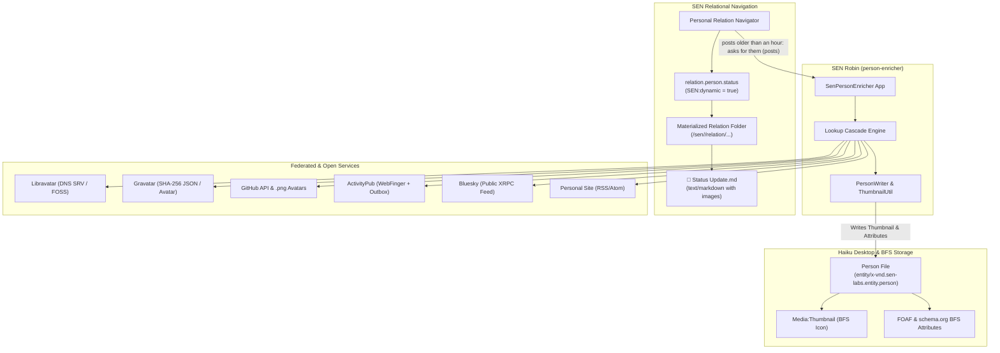
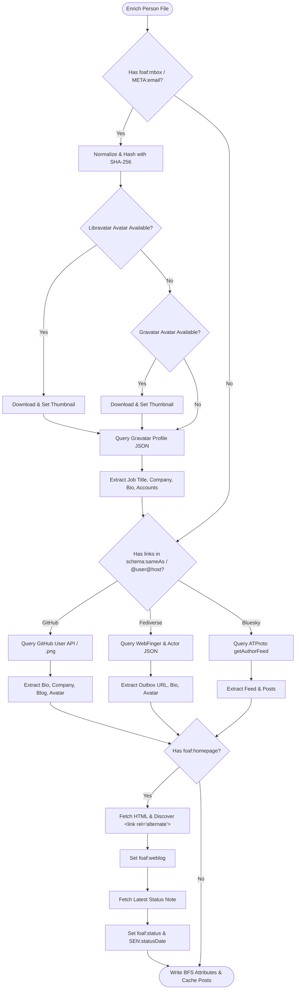
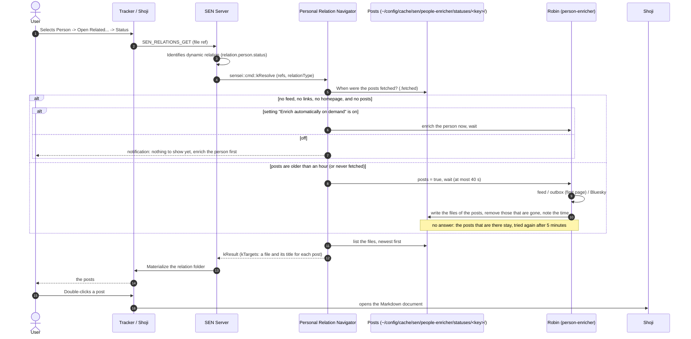

<!--
SPDX-License-Identifier: MIT
SPDX-FileCopyrightText: 2026 SEN Labs e.U.
-->

# Specification: SEN Robin (Person Enricher)

**Version:** 0.1.0-draft  
**Status:** Prototype, working on Haiku (the README says what it does; this says why)  
**Signature:** `application/x-vnd.sen-plugin.sen-labs.person-enricher`  
**Companion Navigator:** `application/x-vnd.sen-plugin.sen-labs.personal-relation-navigator`

---

## 1. Overview & Architectural Goals

**Robin** is the native person enrichment engine for the SEN semantic desktop on Haiku OS. It bridges local contacts (`entity/x-vnd.sen-labs.entity.person` and `application/x-person`) with open identity networks, decentralized avatars, and federated microfeeds.

### Core Tenets
1. **Zero Attribute Bloat**: Only core identity anchors (`foaf:weblog`, `foaf:status`, `foaf:homepage`, `schema:jobTitle`) are stored as BFS file attributes.
1. **Identity by links, never by name**: an account is the one that a link of the file names (`schema:sameAs`), a handle written as `@user@host`, or what the e-mail hash and the homepage lead to. A nickname is not an account.
2. **On-Demand Dynamic Relations**: Status streams and microfeed posts are Markdown files (`text/markdown`) that the relation *status* shows; they are fetched again when they are an hour old. A person that has nothing to ask is enriched on demand if the setting *Enrich automatically on demand* says so, else the user is told.
3. **Open Protocols First**: Prioritizes open standards (Libravatar, ActivityPub, WebFinger, RSS/Atom, ATProto) and open knowledge graphs (Wikidata) over proprietary walled gardens.
4. **Local Privacy**: One-way SHA-256 email hashing; raw email addresses never cross the network.

---

## 2. System Architecture



---

## 3. Lookup & Resolution Cascade



---

## 4. Ontological Schema & BFS Attribute Mapping

Mapped under `sen-oni/schema/sen-people.yaml`:

### Entity Attributes (`entity/x-vnd.sen-labs.entity.person`)

| Attribute Name | Slot URI | Data Type | Editable | Searchable | Description |
|---|---|---|---|---|---|
| `foaf:name` | `foaf:name` | `CSTR` | Yes | Yes | Full display name |
| `foaf:nick` | `foaf:nick` | `CSTR` | Yes | Yes | Nickname / handle |
| `foaf:mbox` | `foaf:mbox` | `CSTR` | Yes | Yes | E-mail address |
| `foaf:homepage` | `foaf:homepage` | `CSTR` | Yes | No | Personal website or blog |
| `schema:jobTitle` | `schema:jobTitle` | `CSTR` | Yes | Yes | Job title or current role |
| `dc:description` | `dc:description` | `CSTR` | Yes | Yes | Biography / about text |
| `schema:sameAs` | `schema:sameAs` | `CSTR` (List, `,`) | Yes | No | Verified account URLs |
| `schema:image` | `schema:image` | `CSTR` | Yes | No | Original URL of the photo |
| `schema:creditText` | `schema:creditText` | `CSTR` | Yes | No | Attribution / photo credit |
| `schema:license` | `schema:license` | `CSTR` | Yes | No | License of the photo |
| `foaf:weblog` | `foaf:weblog` | `CSTR` | Yes | No | The feed of the posts: RSS, Atom, the outbox of an ActivityPub actor, the RSS feed of a Bluesky profile |
| `foaf:status` | `foaf:status` | `CSTR` | Yes | Yes | Latest microfeed note text |
| `SEN:statusDate` | `schema:dateModified` | `TIME` | Yes | Yes | When the latest post was made (not when it was found) |
| `Media:Thumbnail` | System Attribute | Raw Bitmap | No | No | Scaled thumbnail image |

### Dynamic Status Relation (`relation/x-vnd.sen-labs.relation.person.status`)

* **Group**: `Personal`
* **Label**: `status`
* **Inverse Label**: `status of`
* **Dynamic**: `true` (Resolved at runtime by Personal Relation Navigator)
* **Source Types**: `entity/x-vnd.sen-labs.entity.person`, `application/x-person`
* **Target Type**: `text/markdown`

---

## 5. Dynamic Status Relation Lifecycle



---

## 6. Materialized Markdown Document Format

When a status post is expanded into the relation folder, it is created as a first-class BFS file:

### File Metadata
* **File Name**: `2026-11-08 18.00 - Robin Prototype Finished.md`
* `META:TYPE` = `text/markdown`
* `dc:title` = Post headline (up to 60 characters)
* `dc:date` = the time of the post (`'TIME'`), as the feed says it
* `schema:url` = Original permalink on Mastodon, Bluesky, or web

### Content Structure
```markdown
# 2026-11-08 18:00 — Robin Prototype Finished

*By Gregor Rosenauer on 2026-11-08T18:00:00Z*

Just finished the first prototype of **Robin** for SEN! 🎉 
Enriching contacts with public photos and open federated microfeeds.


---
[Original Post](https://mastodon.social/@gregor/1134567890) · *Tags: #haiku #sen*
```

---

## 7. Security, Privacy & Performance

1. **Email Anonymity**: Email addresses are stripped of whitespace, lowercased, and converted to hexadecimal SHA-256 digests. Neither Gravatar nor Libravatar receives plaintext emails.
2. **Rate Limiting**: Uses `sensei::RateLimiter` with a file-backed timestamp (`rate_stamp`) to guarantee polite spacing ($\ge 500\text{ ms}$) across concurrent invocations.
3. **Multi-Tier Caching**:
   - HTTP responses: 7 days (`~/config/cache/sen/people-enricher/`).
   - Feed answers: 1 hour; the posts are fetched again when they are older (`~/config/cache/sen/people-enricher/statuses/<SEN:ID or inode of the person>/`, the time of the fetch is the file `.fetched`).
4. **Offline Resilience**: Cached profiles, thumbnails, and markdown status posts remain fully readable in Tracker and Shoji even when disconnected from the network.
